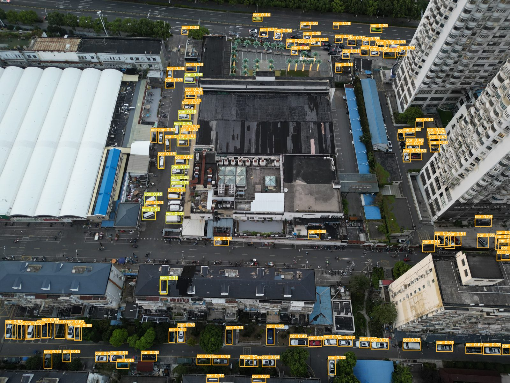
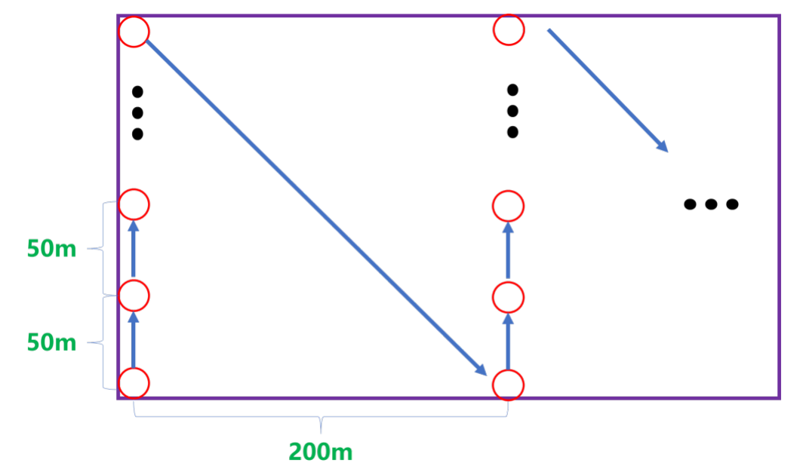
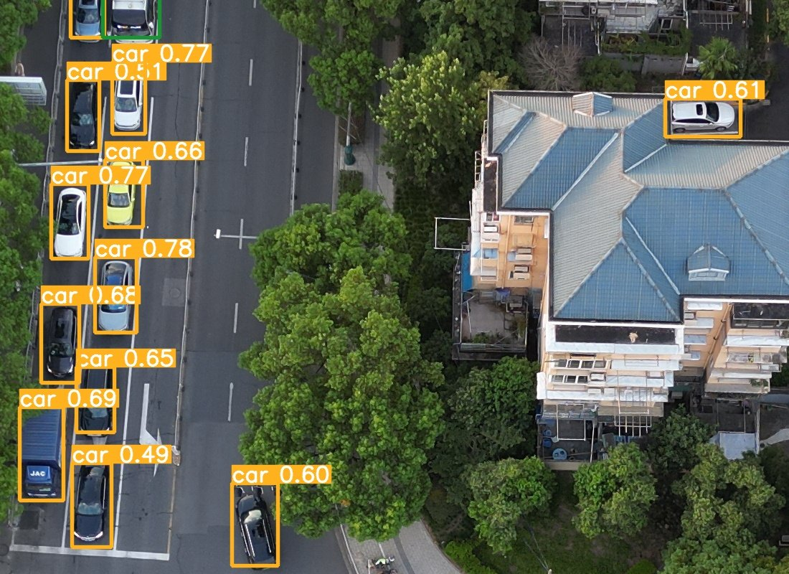
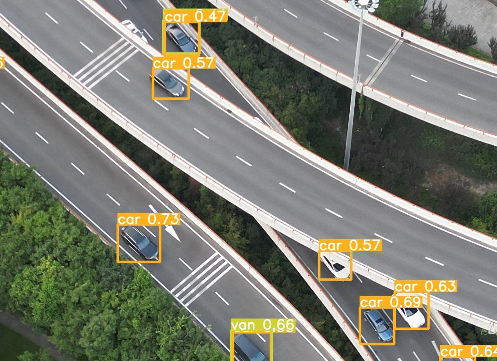
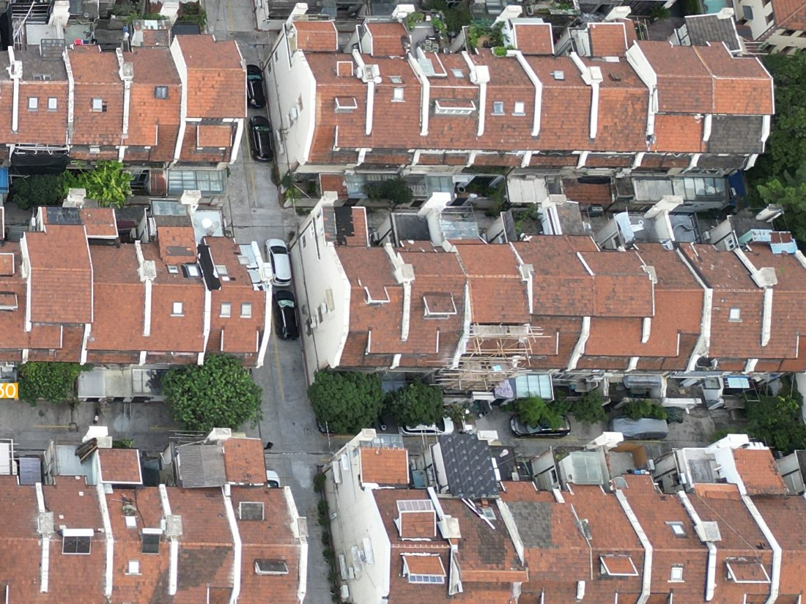

# UAV Vehicle Detection for Smart-City Imagery

Vehicle detection in drone imagery collected over Shanghai, with a comparison of one-stage (YOLO) and two-stage (R-CNN) detectors for accuracy and speed.



## Overview

The project has two parts:

1. **Data collection.** We flew a DJI Mini 3 Pro over three high-traffic urban areas in Shanghai (August 2023) and captured high-resolution oblique aerial images on a fixed survey pattern.
2. **Detector benchmark.** We compared six YOLO and R-CNN detectors trained on the public VisDrone2019 dataset for accuracy and inference speed, and ran YOLOv5 on our own imagery to study where it succeeds and fails.

## Data collection

| Setting | Value |
|---|---|
| Drone | DJI Mini 3 Pro |
| Altitude | 120 m |
| Camera angle | 60° below horizontal |
| Resolution | 4032 × 3024, sRGB |
| Exposure | Automatic (ISO, aperture, shutter) |
| Areas | 3 high-traffic districts in Shanghai |

Each area was covered with a serpentine pattern: fly north taking a photo roughly every 50 m, return to a point about 200 m east of the previous start, and repeat until the rectangle is covered.



## Models and setup

- **Models:** detectors trained on [VisDrone2019-DET](https://github.com/VisDrone/VisDrone-Dataset), drone imagery from 14 Chinese cities with 10 annotated object categories (pedestrian, car, van, bus, truck, and others).
- **Testing on our imagery:** the Shanghai images are used for qualitative evaluation of a VisDrone-trained YOLOv5 model.
- **Hardware:** NVIDIA Tesla T4 GPU, Intel Xeon Gold 5117 CPU.
- **Input size:** 640 × 640.

## Results

Accuracy and speed of the six detectors:

| Method | mAP | AP50 | AP75 | FPS |
|---|---:|---:|---:|---:|
| YOLO (v1) | 6.37 | 18.88 | 3.21 | 15.66 |
| YOLOv3 | 8.63 | 21.83 | 4.98 | 47.85 |
| **YOLOv5** | 15.40 | 37.50 | 10.27 | **60.77** |
| Fast R-CNN | 12.40 | 35.22 | 8.59 | 10.22 |
| Faster R-CNN | 16.50 | 40.15 | 11.39 | 22.02 |
| **Mask R-CNN** | **22.50** | **45.70** | **15.48** | 24.80 |

Mask R-CNN is the most accurate (AP50 45.70). YOLOv5 is the fastest (60.77 FPS) at about 2.5× Mask R-CNN's throughput, which makes it the practical choice for real-time monitoring.

## Qualitative results on our Shanghai imagery

| Dense roadside parking | Overpass traffic |
|---|---|
|  |  |

YOLOv5 finds most vehicles on open roads and in dense roadside parking, including cars partly hidden by tree canopy.

**Failure cases.** Recall drops in old residential blocks. In the crop below, cars parked in narrow alleys between rows of houses are missed. We also observed false positives in the same kind of scene, where rooftop windowsills are detected as vehicles.



All eight annotated full scenes are in [`assets/detections/`](assets/detections/).

## Reproducing the YOLOv5 pipeline

The YOLOv5 experiments use the unmodified [Ultralytics YOLOv5](https://github.com/ultralytics/yolov5) code at commit `dd10481` (August 2023), so the script below pulls it instead of copying it into this repository.

The original VisDrone checkpoint was not preserved. If you have VisDrone-trained YOLOv5 weights, pass them in and the script only runs detection:

```bash
WEIGHTS=path/to/visdrone_yolov5.pt bash scripts/reproduce.sh path/to/uav_images
```

Without `WEIGHTS`, the script trains a new model on VisDrone first, so its numbers will not exactly match the table above:

```bash
bash scripts/reproduce.sh path/to/uav_images
```

The script:

1. Clones YOLOv5 into `third_party/yolov5` and checks out the pinned commit.
2. If no `WEIGHTS` are given, trains on VisDrone (`VisDrone.yaml` downloads the dataset automatically) at 640 × 640 and evaluates on the validation split.
3. Runs detection on your image folder.

Optional settings: `MODEL` (starting checkpoint for training, default `yolov5s.pt`), `EPOCHS` (default 100), `BATCH` (default 16).

The R-CNN baselines were run separately and their code is not included here.

## Repository layout

```
assets/
  detections/        YOLOv5 output on 8 full Shanghai scenes (downscaled)
  examples/          crops used in this README
  flight_pattern.png survey flight pattern
scripts/
  reproduce.sh       train, evaluate, and run YOLOv5 end to end
```

## Authors

Cyrus Wu. The full write-up, *Deep Remote Sensing Object Detection for Smart City Applications*, was submitted to the 2023 S.-T. Yau High School Science Award.

## Acknowledgments

- Advisor: Zhengchuan Zhang, Jinan Foreign Language School.
- [YOLOv5](https://github.com/ultralytics/yolov5) by Ultralytics (AGPL-3.0).
- [VisDrone](https://github.com/VisDrone/VisDrone-Dataset) by the AISKYEYE team, Tianjin University.
